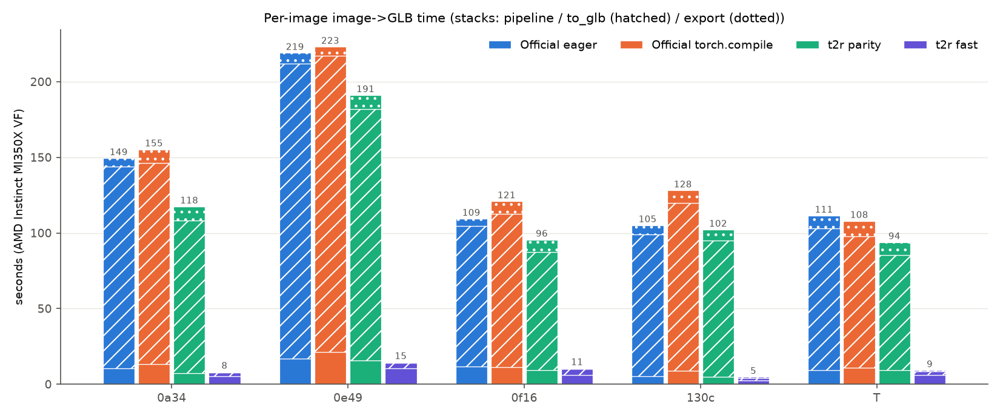
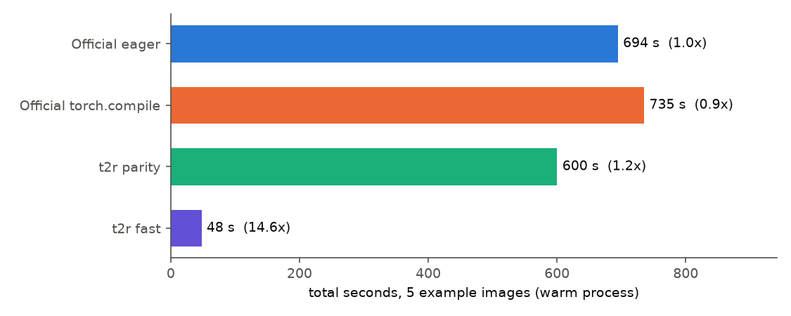
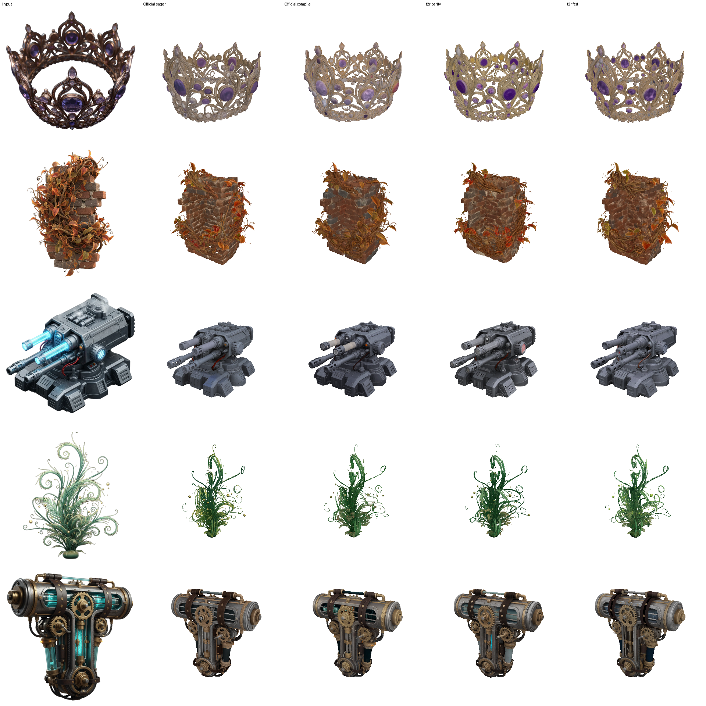

# TRELLIS.2 on ROCm (t2r)

Image → textured GLB for [TRELLIS.2-4B](https://github.com/microsoft/TRELLIS.2) (`1024_cascade`, `example.py` `to_glb`
settings) on AMD Instinct GPUs, modeled on [trellis2-cuda](https://github.com/suvadityamuk/trellis2-cuda). Two modes:

- **parity**: bitwise identical to the official PyTorch pipeline running on ROCm, from the input image to the final
  mesh and PBR voxel attributes, and through every deterministic `to_glb` stage.
- **fast**: HIP kernels and restructured CPU/GPU work, tolerance-bounded against the official pipeline's own spread.

Targets gfx942 (MI300X / MI300A / MI325X) and gfx950 (MI350X / MI355X). Measured on an MI350X (VF), torch 2.13 + ROCm 10.1.

## Results (MI350X, 5 example images, seconds)

| Image | Official eager | Official torch.compile | t2r parity | t2r fast | fast vs eager | fast vs compile |
|---|---|---|---|---|---|---|
| 0a34 | 99.9 | 102.0 | 70.6 | **7.5** | 13.3× | 13.6× |
| 0e49 | 128.0 | 140.7 | 106.7 | **15.4** | 8.3× | 9.2× |
| 0f16 | 89.8 | 103.4 | 78.9 | **10.8** | 8.3× | 9.6× |
| 130c | 90.4 | 92.3 | 78.8 | **5.4** | 16.8× | 17.1× |
| T.png | 91.3 | 90.7 | 74.4 | **8.9** | 10.2× | 10.1× |
| **Sum** | 499.5 | 529.1 | 409.4 (1.22× / 1.29×) | **48.0** | **10.4×** | **11.0×** |

Pipeline + `to_glb` + export, model loading excluded (`tools/bench_ref.py`, `tools/bench_t2r.py`; raw numbers in `bench/`).
Protocol, the same for all four configurations (`--warm-all`): one process, one warmup image, then every image once
untimed, then the timed pass. The untimed pass matters for torch.compile, whose compilation and shape-specific
setup for each new image would otherwise fall inside the timing.

By phase (sum over images, eager → fast): models 59.8 → 29.8 s, `to_glb` 404.3 → 13.6 s, export 35.3 → 4.6 s.

The official numbers move between runs and machine boots, because most of their time is single-threaded xatlas
packing on the CPU: a second eager run on the same boot gave 535.4 s, and an earlier boot of the same VM gave about
700 s (fast: 47.7 s there, 48.0 s here). The fast build's time is stable, so the ratio follows the baseline.




## Where the time goes

The official pipeline spends about 80% of its time in serial CPU post-processing, not in the networks: of the 451 s
the fast build saves over the five images, 391 s is in `to_glb`. What each mode changes, stage by stage:

| Stage | Official baseline | t2r parity (bitwise identical) | t2r fast |
|---|---|---|---|
| UV unwrap | xatlas packs ~16k charts one at a time on one CPU thread: 30–53 s per image | Same packing, kept for parity | Charts split into 64 groups packed in parallel threads, then tiled: 1.2–2.8 s (2–4% lower texel density) |
| Texture inpainting | 4 × `cv2.inpaint` on the CPU: ~20 s | Same algorithm, run in parallel: 10–16 s | GPU TELEA kernel that fills by distance level: ~0.05 s |
| BVH for remesh and bake | cuBVH built serially on the CPU: 6.8 s | Same | GPU linear BVH: 0.10–0.16 s |
| Mesh ops (simplify, chart clustering) | CuMesh with a `hipMalloc` per iteration and host-side fills | `t2r_cumesh`: caching allocator, device-side fills, same arithmetic | Same as parity |
| Texture bake sampling | FlexGEMM Triton kernel, autotuned per image (~2 s) | HIP kernel reproducing it bitwise, no autotuning | Fused hash lookup and trilinear sample in one kernel |
| GLB export | trimesh export with slow WebP encoding: 5.8–7.7 s | Same | Direct GLB writer, fast WebP setting, textures encoded in parallel: 0.6–1.3 s |
| Diffusion transformers | Separate ops, two passes for guidance: 314 ms per step at 13k tokens | Same calls in the same order | Fused norm / RoPE / residual kernels, guidance batched into one pass, cached cross-attention K/V: 179 ms |
| DiT attention | CK flash-attention | Same | PyTorch SDPA (AOTriton) |
| **Total, 5 images** | **499.5 s** | **409.4 s (1.22×)** | **48.0 s (10.4×)** |

The parity and fast sections below give the details and the accuracy cost of each fast-build change.

## Run it

```bash
tools/setup_rocm.sh                                                # once: deps, ROCm ports, t2r, weights (HF_TOKEN in .env)
python examples/image_to_glb.py image.png --out out.glb            # fast mode; --mode parity for the bitwise path
```

The input must be RGBA with the background already removed. A fresh process takes about 22 s to load the models and
about 20 s for its first image (one-time kernel and cache warmup); later images in the same process take the times
in the table above.

## Outputs



Turntable of the fast build for `T.png`: `docs/T_fast.gif`.

## Getting the official pipeline running on ROCm

The official code does not run on ROCm as shipped: nvdiffrast has no HIP path, CuMesh fails to build, and the sparse
DiTs only support flash-attn/xformers. Ported here (`patches/`, `tools/setup_rocm.sh`):

| Dependency | What it took |
|---|---|
| nvdiffrast v0.4.0 | The CUDA rasterizer is written for 32-lane warps (`blockDim = (32, warps)`). On wave64 CDNA one wavefront holds two logical warps, so every ballot/shuffle/lane-mask is reimplemented on the caller's 32-lane half (`cr_warp32.h`). All inline PTX replaced with exact equivalents (`set.ge.u32` is all-ones, `prmt` nibble bit 3 is sign replication, sub-word `vadd` merges into `c`, `__frcp_rz`, `fma.rm`). Validated against a brute-force rasterizer at 4096² and for determinism. |
| CuMesh | cub's tuple-decomposer radix sort (not in hipCUB) replaced by three stable passes, which give the identical permutation; reduce op; build flags. |
| flash-attention | ROCm CK backend, built for the target architectures. |
| FlexGEMM, o-voxel | Build as-is with `GPU_ARCHS`. |

## Parity

Method as in trellis2-cuda: `tools/ref_dump.py` records every stage of the official pipeline, `tools/parity.py` feeds
each t2r stage the official stage inputs and compares bytes.

| Stage | 5 images |
|---|---|
| DINOv3 cond (512, 1024), SS sampling + decode, shape 512 → upsample → 1024, texture, decoders, `fill_holes` | **55/55 bitwise** (`final.v/f/attrs/coords` included) |
| remesh, UV unwrap, texture bake, the four TELEA inpaints | **55/55 bitwise** |
| simplify | nondeterministic in the official code (two official runs on identical input differ) |

What parity needed:
- **Same library calls, same layouts.** hipBLASLt through `F.linear`, CK flash-attention with the official
  (packed/varlen) call forms, MIOpen conv3d, FlexGEMM Triton sparse conv with the shared autotune cache, and the same
  ATen elementwise/normalization ops in the same order and dtypes (RoPE complex multiplies, `F.normalize` RMSNorm,
  bf16 rounding points, CPU `torch.randn`).
- **A bitwise HIP replacement for FlexGEMM's trilinear weighted sum.** Each output is a sequential fp32 sum over the 8
  neighbors (unfused multiply-add), independent of the Triton tile, so it reproduces the kernel without its per-image
  autotuning (~2 s/image).
- **A fixed reference.** On gfx950, PyTorch's fp32 memory-efficient SDPA (AOTriton) intermittently returns *wrong*
  results above ~2k tokens (errors up to 1.5e-2 on outputs of magnitude 0.02; correct runs are at 5e-7). DINOv3 at
  1024² has 4101 tokens, so the official 1024 conditioning changes every run (13 distinct outputs in 20 runs). The parity
  reference pins DINOv3 attention to PyTorch's MATH backend (`tools/refenv.py`); with that, two official runs are
  82/82 bitwise. Speed baselines use the official code as shipped.

Parity mode is only modestly faster: it has to keep the official xatlas packing (30–53 s per image in the run above). Its savings come
from the FlexGEMM autotuning, parallel inpainting, and `t2r_cumesh`, a build of CuMesh whose allocations go through the
PyTorch caching allocator and whose buffer fills run on the device. Upstream allocates per iteration (`hipMalloc` is slow)
and builds host vectors for `fill()` (~300 MB pageable copies). Neither change alters any arithmetic.

## Fast build

| Change | Effect |
|---|---|
| Grouped parallel xatlas: charts > 1024 faces split, 64 area-balanced group atlases packed in native threads with a shared texel scale, then shelf-tiled | UV unwrap 30–53 s → 1.2–2.8 s; texel density 2–4% lower than official |
| GPU LBVH (Morton + hipCUB radix sort + Karras tree) instead of cuBVH's CPU build | BVH build 6.8 s → 0.10–0.16 s |
| GPU wavefront TELEA + uint8 conversion + glTF texture packing | 4 inpaints ~20 s → 49 ms |
| `t2r_cumesh` (caching allocator, device fills) | no per-iteration `hipMalloc` or host-side fills in simplify and chart clustering (also used in parity) |
| Fused DiT kernels (LN+modulate, QK-RMSNorm+RoPE+pack, gated residual + LN), GELU fused in the GEMM epilogue, cross-attention K/V cached per run, CFG cond/uncond batched | DiT step with CFG 314 → 179 ms at 13k tokens |
| PyTorch SDPA (AOTriton bf16 flash) for DiT attention | ~20% faster than CK at these shapes, deterministic, as accurate |
| Fused sparse-voxel trilinear sampling; direct GLB writer, WebP method 0, textures encoded in parallel | export 5.8–7.7 s → 0.6–1.3 s |

**Tolerance** (`tools/tolerance.py`: symmetric Chamfer / bbox diagonal, base-color L1 at matched surface samples, vs official eager):

| Image | official compile | official (pinned attention) | t2r parity | t2r fast |
|---|---|---|---|---|
| 0a34 | 2.14e-3 / 21.7 | 2.09e-3 / 16.9 | 2.09e-3 / 16.9 | 2.11e-3 / 19.4 |
| 0e49 | 3.90e-3 / 18.2 | 3.58e-3 / 18.9 | 3.58e-3 / 18.9 | 3.57e-3 / 18.6 |
| 0f16 | 2.66e-3 / 19.4 | 2.70e-3 / 23.3 | 2.70e-3 / 23.3 | 2.57e-3 / 30.8 |
| 130c | 4.00e-3 / 23.5 | 4.22e-3 / 24.7 | 4.22e-3 / 24.7 | 4.23e-3 / 24.1 |
| T | 2.61e-3 / 24.1 | 2.73e-3 / 22.8 | 2.73e-3 / 22.8 | 2.58e-3 / 28.6 |

The fast build falls inside the band of the official configurations against each other. Teacher-forced, a fast DiT
call differs from the official by 0.3–0.6% relative L2.

Neither mode writes the same GLB twice: mesh simplification is nondeterministic, in the official code as well. Two fast
runs of `T.png` differ by 1.3e-3 Chamfer / 5.9 color L1, and two official runs with pinned attention by 0.8–1.4e-3 /
2.7–5.9 (`bench/tolerance_ref.json`).

Fast-build trade-offs: ~1% more UV seams from chart splitting; TELEA fill order differs in texels outside the charts;
the (unused, `alphaMode: OPAQUE`) base-color alpha channel is WebP-encoded at `alpha_quality=0`.

What didn't help: aiter's FMHA (same ~920 TF/s as AOTriton, bitwise-identical output); HIP graphs (DiT forwards are
already 90–95% GPU-busy). Not attempted: FP8 GEMMs.

## Layout

- `csrc/`: HIP kernels (`dit_fast.hip`, `lbvh.hip`, `telea.hip`, `grid_sample.hip`), the grouped xatlas packer
  (`uv_atlas.cpp`, vendored xatlas with a fix for a task-queue use-after-free in its scheduler), bindings. `setup.py` builds `t2r._C` for `T2R_ARCHS` (default `gfx942;gfx950`).
- `t2r/`: `dit.py` (four flow DiTs, parity + fast paths), `sampler.py`, `pipeline.py`, `glb.py` (`to_glb` stages, GLB writer).
- `tools/`: setup, reference dumps, parity checks, benchmarks, tolerance, renders, plots. `tests/`: kernel tests.
- `patches/`: the CuMesh and nvdiffrast ROCm ports.
- `examples/image_to_glb.py`: one image end to end.
- `hub/trellis2-rocm/`: the reusable kernels (`mesh_udf`, `telea_inpaint`, `grid_sample_trilinear`, `pack_charts`) as a
  [Kernel Hub](https://huggingface.co/docs/kernels) package, published as `suvadityamuk/trellis2-rocm`.

The sparse-structure and SLat VAE decoders (~3% of the warm runtime) still use the official modules.

## Reproduce

```bash
tools/setup_rocm.sh                                            # deps, ROCm ports, t2r, weights (HF_TOKEN in .env)
python tools/ref_dump.py --out out/ref                         # official stage dumps
PYTHONPATH=. python tools/parity.py pipe remesh simplify unwrap bake textures
python tools/bench_ref.py --mode eager --warm-all --out bench/eager.json --glb-dir out/eager      # also --mode compile
PYTHONPATH=. python tools/bench_t2r.py --mode fast --stages --warm-all --out bench/fast.json --glb-dir out/fast   # also --mode parity
python tools/tolerance.py --out bench/tolerance.json eager=out/eager fast=out/fast
python tools/plot_bench.py
```

Only gfx950 was available for testing; the gfx942 code paths are built but untested.

## Related

Part of [TRELLIS.2 everywhere](https://huggingface.co/collections/hugging-3d/trellis2-everywhere-6b062cf7d5ae3eca49def35b), built on Microsoft's [TRELLIS.2](https://huggingface.co/microsoft/TRELLIS.2-4B) ([paper](https://huggingface.co/papers/2512.14692)).

| | Hugging Face | GitHub |
|---|---|---|
| Guide | [The Definitive Fine-Tuning Guide for 3D Generation Models](https://huggingface.co/blog/3d-lora-finetuning) | |
| Fine-tuning (LoRA) | [footwear LoRA](https://huggingface.co/suvadityamuk/trellis-2-finetune-gso) · [trainer Space](https://huggingface.co/spaces/hugging-3d/3d-model-lora-trainer) · [subset builder](https://huggingface.co/spaces/hugging-3d/data-finetuning-subset-builder) | [trellis2-finetuning](https://github.com/suvadityamuk/trellis2-finetuning) |
| Data | [GSO footwear](https://huggingface.co/datasets/suvadityamuk/gso-footwear-trellis2-latents) · [GSO](https://huggingface.co/datasets/hugging-3d/gso-trellis2-latents) · [Smithsonian](https://huggingface.co/datasets/hugging-3d/smithsonian-trellis2-latents) · [NASA](https://huggingface.co/datasets/hugging-3d/nasa-trellis2-latents) latents | |
| Diffusers port | [TRELLIS.2-4B-diffusers-3d](https://huggingface.co/suvadityamuk/TRELLIS.2-4B-diffusers-3d) | [diffusers-3d](https://github.com/suvadityamuk/diffusers-3d) |
| NVIDIA (CUDA C++) | [kernels](https://huggingface.co/kernels/suvadityamuk/trellis2-cuda) · [Space](https://huggingface.co/spaces/suvadityamuk/trellis2-cuda) | [trellis2-cuda](https://github.com/suvadityamuk/trellis2-cuda) |
| Apple Silicon (Metal) | [kernels](https://huggingface.co/kernels/suvadityamuk/trellis2-metal) | [trellis2-metal](https://github.com/suvadityamuk/trellis2-metal) |
| AMD (ROCm/HIP) | [kernels](https://huggingface.co/kernels/suvadityamuk/trellis2-rocm) | [trellis2-rocm](https://github.com/suvadityamuk/trellis2-rocm) |