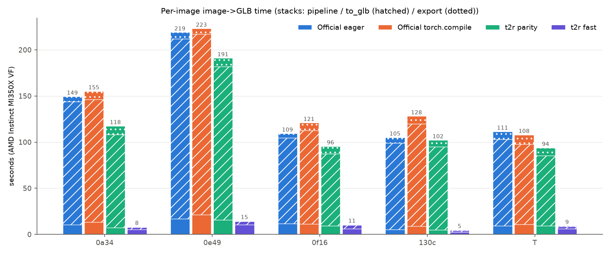
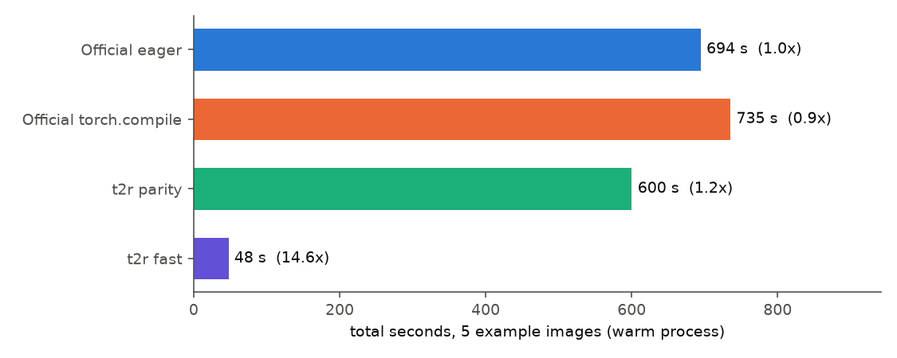

# trellis2-rocm

Four standalone kernels for AMD Instinct GPUs from [TRELLIS.2 on ROCm](https://github.com/suvadityamuk/trellis2-rocm), a port of
Microsoft's [TRELLIS.2](https://github.com/microsoft/TRELLIS.2) image-to-3D pipeline. In the port, they replace serial CPU steps in mesh post-processing:

| Function | Runs on | What it does | In the port (MI350X) |
|---|---|---|---|
| `mesh_udf` | GPU | Distance from query points to a triangle mesh, plus the nearest face and barycentric coordinates. Builds a GPU linear BVH on each call. | BVH build 6.8 s → 0.10–0.16 s (vs. cuBVH's CPU build) |
| `telea_inpaint` | GPU | TELEA inpainting, an alternative to `cv2.inpaint(..., cv2.INPAINT_TELEA)`. | Four 4096² texture inpaints: ~20 s → 49 ms |
| `grid_sample_trilinear` | GPU | Trilinear sampling of features stored on a sparse voxel grid, any channel count. | 6.7M samples of 6 channels in 2.2 ms |
| `pack_charts` | CPU | Parallel xatlas UV parameterization and packing of pre-cut charts. | UV unwrap 30–53 s → 1.2–2.8 s |

## Benchmarks

The numbers are for the whole image → textured GLB pipeline of the port (`t2r`), which is where these kernels run.
MI350X (VF), torch 2.13 + ROCm 10.1, TRELLIS.2-4B `1024_cascade`, five example images, seconds per image:

| Image | Official eager | Official torch.compile | t2r parity | t2r fast | fast vs eager | fast vs compile |
|---|---|---|---|---|---|---|
| 0a34 | 99.9 | 102.0 | 70.6 | **7.5** | 13.3× | 13.6× |
| 0e49 | 128.0 | 140.7 | 106.7 | **15.4** | 8.3× | 9.2× |
| 0f16 | 89.8 | 103.4 | 78.9 | **10.8** | 8.3× | 9.6× |
| 130c | 90.4 | 92.3 | 78.8 | **5.4** | 16.8× | 17.1× |
| T.png | 91.3 | 90.7 | 74.4 | **8.9** | 10.2× | 10.1× |
| **Sum** | 499.5 | 529.1 | 409.4 (1.22× / 1.29×) | **48.0** | **10.4×** | **11.0×** |

- **t2r parity** is bitwise identical to the official PyTorch pipeline running on ROCm. **t2r fast** uses the kernels
  in this repository plus fused diffusion-transformer kernels, and is tolerance-bounded against the official pipeline.
- Times cover the networks, `to_glb` and GLB export; model loading is excluded. All four configurations use the same
  protocol: one process, one warmup image, then every image once untimed, then the timed pass.
- By phase, summed over the five images:

| Phase | Official eager | Official torch.compile | t2r parity | t2r fast |
|---|---|---|---|---|
| Networks | 59.8 | 66.7 | 50.2 | 29.8 |
| `to_glb` (mesh post-processing) | 404.3 | 422.0 | 312.2 | 13.6 |
| GLB export | 35.3 | 40.4 | 46.9 | 4.6 |

The official numbers move between runs and machine boots, because most of their time is single-threaded xatlas packing
on the CPU: a second eager run on the same boot gave 535.4 s, and an earlier boot of the same VM gave about 700 s
(fast: 47.7 s there, 48.0 s here). The fast build's time is stable, so the ratio follows the baseline.




Raw numbers, benchmark scripts and the accuracy comparison are in the
[port's repository](https://github.com/suvadityamuk/trellis2-rocm) (`bench/`, `tools/bench_ref.py`, `tools/bench_t2r.py`).

## Where the time goes

The official pipeline spends about 80% of its time in serial CPU post-processing, not in the networks: of the 451 s
the fast build saves over the five images, 391 s is in `to_glb`. What each mode changes, stage by stage, and which
kernel from this repository does it:

| Stage | Official baseline | t2r parity (bitwise identical) | t2r fast | Kernel here |
|---|---|---|---|---|
| UV unwrap | xatlas packs ~16k charts one at a time on one CPU thread: 30–53 s per image | Same packing, kept for parity | Charts split into 64 groups packed in parallel threads, then tiled: 1.2–2.8 s (2–4% lower texel density) | `pack_charts` |
| Texture inpainting | 4 × `cv2.inpaint` on the CPU: ~20 s | Same algorithm, run in parallel: 10–16 s | GPU TELEA kernel that fills by distance level: ~0.05 s | `telea_inpaint` |
| BVH for remesh and bake | cuBVH built serially on the CPU: 6.8 s | Same | GPU linear BVH: 0.10–0.16 s | `mesh_udf` |
| Texture bake sampling | FlexGEMM Triton kernel, autotuned per image (~2 s) | HIP kernel reproducing it bitwise, no autotuning | Fused hash lookup and trilinear sample in one kernel | `grid_sample_trilinear` |
| Mesh ops (simplify, chart clustering) | CuMesh with a `hipMalloc` per iteration and host-side fills | `t2r_cumesh`: caching allocator, device-side fills, same arithmetic | Same as parity | in the port |
| GLB export | trimesh export with slow WebP encoding: 5.8–7.7 s | Same | Direct GLB writer, fast WebP setting, textures encoded in parallel: 0.6–1.3 s | in the port |
| Diffusion transformers | Separate ops, two passes for guidance: 314 ms per step at 13k tokens | Same calls in the same order | Fused norm / RoPE / residual kernels, guidance batched into one pass, cached cross-attention K/V: 179 ms | in the port |
| DiT attention | CK flash-attention | Same | PyTorch SDPA (AOTriton) | in the port |
| **Total, 5 images** | **499.5 s** | **409.4 s (1.22×)** | **48.0 s (10.4×)** | |

The first four rows are the reusable part and are what this repository packages. The rest is specific to TRELLIS.2 and
lives in the [port's repository](https://github.com/suvadityamuk/trellis2-rocm), which also documents the
bitwise-parity method and the accuracy cost of each fast-build change.

## Usage

```python
# pip install -U kernels
import torch
from kernels import get_kernel

k = get_kernel("{{ repo_id }}", version={{ version }}, trust_remote_code=True)

# Point-to-mesh distance
vertices = torch.rand(1000, 3, device="cuda")                    # float32 [V, 3]
faces = torch.randint(0, 1000, (500, 3), device="cuda")          # int32/int64 [F, 3]
points = torch.randn(4096, 3, device="cuda")                     # float32 [M, 3]
dist, face_id, bary = k.mesh_udf(vertices, faces, points)        # [M], [M] int64, [M, 3]

# Inpainting
image = torch.randint(0, 256, (512, 512, 3), dtype=torch.uint8, device="cuda")
mask = torch.zeros(512, 512, dtype=torch.bool, device="cuda")
mask[200:300, 200:300] = True                                    # nonzero = fill
filled = k.telea_inpaint(image, mask, radius=3)                  # uint8, same shape as image

# Sparse-voxel trilinear sampling
coords = torch.unique(torch.randint(0, 64, (5000, 3), device="cuda", dtype=torch.int32), dim=0)  # int32 [N, 3]
feats = torch.randn(coords.shape[0], 6, device="cuda")           # float32 [N, C]
query = torch.rand(10000, 3, device="cuda") * 64                 # float32 [M, 3], grid space
sampled = k.grid_sample_trilinear(feats, coords, query, (64, 64, 64))  # float32 [M, C]

# UV packing of charts (CPU tensors): two quads as two charts
v = torch.tensor([[0, 0, 0], [1, 0, 0], [1, 1, 0], [0, 1, 0],
                  [0, 0, 1], [1, 0, 1], [1, 1, 1], [0, 1, 1]], dtype=torch.float32)
f = torch.tensor([[0, 1, 2], [0, 2, 3], [4, 5, 6], [4, 6, 7]], dtype=torch.int32)
vmap, uv_faces, uvs = k.pack_charts(v, f, torch.tensor([0, 4, 8]), torch.tensor([0, 2, 4]))
```

## API

`mesh_udf(vertices, faces, points) -> (distance, face_id, barycentric)`

- `vertices`: float32 `[V, 3]`, GPU. `faces`: int32 or int64 `[F, 3]`, at least one face. `points`: float32 `[M, 3]`.
- Returns the unsigned distance (float32 `[M]`), the index of the nearest face (int64 `[M]`), and the barycentric coordinates of the closest point on that face (float32 `[M, 3]`).
- When several faces are equally close, the lowest face index wins, so results don't depend on the BVH's shape. Degenerate (zero-area) triangles are handled.

`telea_inpaint(image, mask, radius=3) -> image`

- `image`: uint8 `[H, W]` or `[H, W, C]` with `C <= 4`, GPU. `mask`: `[H, W]` bool or uint8; nonzero pixels are filled. `radius`: neighborhood radius in pixels.
- Pixels outside the mask are returned unchanged.

`grid_sample_trilinear(feats, coords, points, grid_size) -> sampled`

- `feats`: float32 `[N, C]`, GPU. `coords`: int32 `[N, 3]` as `(x, y, z)`, or `[N, 4]` as `(batch, x, y, z)` with the batch column ignored; coordinates must be unique and inside the grid. `points`: float32 `[M, 3]` in grid space. `grid_size`: `(W, H, D)`.
- Voxel `(i, j, k)` spans `[i, i+1)` on each axis, so its center is at `(i + 0.5, j + 0.5, k + 0.5)`.
- Each point blends the up to 8 voxels whose centers surround it. Weights are renormalized over the voxels that exist, and a point with no occupied neighbor returns zeros. On a dense grid this equals `torch.nn.functional.grid_sample` (`align_corners=False`) away from the border.

`pack_charts(vertices, faces, vertex_offsets, face_offsets, num_groups=64, num_threads=0, max_chart_faces=1024) -> (vertex_map, faces, uvs)`

- All inputs are CPU tensors. `vertices`: float32 `[V, 3]`, the vertices of all charts concatenated. `faces`: int32 `[F, 3]` indexing `vertices`; a chart's faces reference only its own vertices. `vertex_offsets`, `face_offsets`: integer `[num_charts + 1]`, the start of each chart's vertices and faces plus the totals.
- Returns `vertex_map` (int32 `[V']`), `faces` (int32 `[F', 3]`) and `uvs` (float32 `[V', 2]` in `[0, 1]`). Output vertex `i` is a copy of `vertices[vertex_map[i]]`.
- Charts are split into `num_groups` groups of similar area. Each group is unwrapped and packed by xatlas on its own thread at a shared texel scale, and the group atlases are tiled into one. In the port this costs 2–4% of texel density compared with packing everything in one xatlas atlas.
- Charts with more than `max_chart_faces` faces are split first, which adds UV seams along the cuts; `0` disables splitting. `num_threads=0` uses all hardware threads.
- The result is deterministic and does not depend on `num_threads`.

## Accuracy

- `mesh_udf` matches a float64 brute-force reference to within 1e-5, for both the distance and the chosen face.
- `grid_sample_trilinear` matches a float64 reference to within 1e-5.
- `telea_inpaint` is close to OpenCV's output but not identical. OpenCV fills pixels one at a time in fast-marching order; this kernel fills every pixel at the same integer distance from known pixels in parallel, using TELEA's weights. On the test image, the mean absolute difference from `cv2.inpaint` over inpainted pixels is 4.5 (on a 0–255 scale).
- `pack_charts` produces a valid atlas: every input triangle appears once, no UV triangle is degenerate, and charts do not overlap.

## Compatibility

- Linux x86_64 with ROCm, on gfx942 (MI300X / MI300A / MI325X) and gfx950 (MI350X / MI355X). `get_kernel` picks the build matching your PyTorch and ROCm versions.
- 12 builds from `kernel-builder` cover torch 2.10 through 2.15 with ROCm 7.0, 7.1, 7.2, 7.14 and 10.0.
- 1 extra build, `torch213-rocm101`, covers torch 2.13 with ROCm 10.1, which is outside `kernel-builder`'s matrix. It was built with `build_variant.py` against the ROCm 10.1 SDK on Ubuntu, so it needs glibc 2.43 or newer and is not manylinux_2_28-compatible.
- Known issue: `kernels` 0.18.3 reads the `rocm714` in a build name as ROCm 71.4, so it does not select the two ROCm 7.14 builds. On torch 2.14 + ROCm 7.14 it loads the ROCm 7.2 build instead, which works; on torch 2.15 + ROCm 7.14 it finds no build.

### Test results

The full test suite (34 tests: 4 `mesh_udf`, 7 `telea_inpaint` including the comparison with `cv2.inpaint`, 14 `grid_sample_trilinear`, 9 `pack_charts`) on an AMD Instinct MI350X (gfx950), each build loaded in an environment with the matching PyTorch wheel:

| Build | torch | ROCm | Result |
|---|---|---|---|
| `torch210-rocm70` | 2.10.0 | 7.0 | 34/34 passed |
| `torch210-rocm71` | 2.10.0 | 7.1 | 34/34 passed |
| `torch211-rocm71` | 2.11.0 | 7.1 | 34/34 passed |
| `torch211-rocm72` | 2.11.0 | 7.2 | 34/34 passed |
| `torch212-rocm71` | 2.12.1 | 7.1 | 34/34 passed |
| `torch212-rocm72` | 2.12.1 | 7.2 | 34/34 passed |
| `torch213-rocm71` | 2.13.0 | 7.1 | 34/34 passed |
| `torch213-rocm72` | 2.13.0 | 7.2 | 34/34 passed |
| `torch213-rocm101` | 2.13.0 | 10.1 | 34/34 passed |
| `torch214-rocm72` | 2.14.1 | 7.2 | 34/34 passed |
| `torch214-rocm714` | 2.14.1 | 7.14 | 34/34 passed (loaded directly, see the known issue) |
| `torch215-rocm714` | 2.15.0 | 7.14 | 34/34 passed (loaded directly, see the known issue) |
| `torch215-rocm100` | 2.15.0 | 10.0 | 34/34 passed |

The gfx942 code is compiled into every build but has not been run: no MI300 was available.

## Source and license

The source, tests and build config are in [`hub/trellis2-rocm`](https://github.com/suvadityamuk/trellis2-rocm/tree/main/hub/trellis2-rocm). Licensed under Apache-2.0; the bundled [xatlas](https://github.com/jpcy/xatlas) is MIT-licensed.
